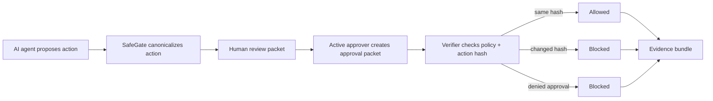

# SafeGate Edge

> **MFA verifies identity. SafeGate verifies the action.**

## 1. What is SafeGate Edge?
SafeGate Edge is a local, verifiable approval boundary for high-risk AI and automation actions. It acts as a deterministic interceptor—halting high-risk actions pending physical human approval, then generating a tamper-evident evidence bundle to prove that the executed action perfectly matches the human-approved intent.

## 2. Why does it matter?
We want AI agents and automation tools to handle more complex work, but we cannot let them unilaterally run destructive commands or mutate high-risk actions after approval. Standard IAM tools focus on *who* is allowed to act; SafeGate focuses on *what exact action* is being approved. By cryptographically binding a human approval to the exact canonical hash of an action request, SafeGate ensures that if an agent hallucinates or mutates an action post-approval, it fails closed.

## 3. Run the Demo
SafeGate includes a deterministic end-to-end demo simulating the approval lifecycle.

```bash
# Clone the repository
git clone <repository_url>
cd safegate_edge

# Run the end-to-end demo
python -m safegate_edge.cli demo run --output-dir examples/demo_runs/safegate_demo
```

The output will include the full lifecycle of an intercepted threat: the human review packet, the cryptographically bound approval, and the exported evidence bundle proving why a mutated action was blocked.

## 4. What the Demo Proves
* **Canonical action hashing:** SafeGate produces a deterministic cryptographic hash for the exact action request, avoiding drift from JSON formatting differences.
* **Hash-bound approval:** An approval packet securely binds an active approver to one exact canonical action hash.
* **Fail-closed mutation blocking:** If the attempted action changes after approval, SafeGate detects the hash mismatch and blocks the action.
* **Denied approval blocking:** A denied approval packet cannot be treated as permission.
* **Policy-bound verification:** SafeGate only allows approval-free actions when a valid policy explicitly says approval is not required.
* **Tamper-evident evidence:** The demo exports a hash-linked evidence bundle showing the decision trace from review through verification.

## 5. Architecture Diagram



## 6. Documentation Links
- [One-Page Overview](docs/one_page_overview.md)
- [Reviewer Packet](docs/reviewer_packet.md)
- [Demo Walkthrough](docs/demo_walkthrough.md)
- [Architecture](docs/architecture.md)
- [Threat Model](docs/threat_model.md)
- [Limitations](docs/limitations.md)
- [Release Notes](docs/release_notes.md)

## 7. Current Limitations
SafeGate is hardware-ready, not hardware-verified yet.
- **Hardware attestation is not implemented yet:** The current demo uses simulated approval packets. Policies can reserve space for hardware attestation, but SafeGate does not yet verify YubiKey, WebAuthn, TPM, Secure Enclave, or passkey evidence.
- **Approver identity is local and static:** The approver registry is currently a JSON configuration file, not a production identity provider integration.
- **No kernel-level sandboxing:** SafeGate is currently a verifier and approval gateway. It relies on an agent framework to call it before execution.
- **Prototype evidence, not certification:** The demo proves the control-plane pattern. It does not certify production security.