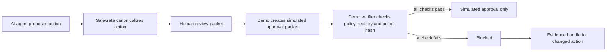

# SafeGate Edge

## 1. What is SafeGate Edge?
SafeGate Edge is a local prototype for checking AI and automation actions against policy. Normal verification denies approval-required actions because the current approval packets lack authenticated approval evidence.

## 2. Why does it matter?
SafeGate hashes the exact action request so the verifier can compare it with the action recorded in a review packet. In the explicit demo, a simulated approval records that hash and the policy context. The verifier checks the policy ID, matching rule and approval requirement against the evaluated policy. It also checks that the named approver is active in the caller-configured registry and that the registry permits the packet's approval method.

Use `python -m safegate_edge.cli verify --help` for normal verification options. The optional `--approvers` flag selects the registry JSON file and defaults to `examples/config/approvers.json`.

## 3. Run the Demo
SafeGate includes a deterministic demo of the approval lifecycle. A matching simulated approval can return `simulated_allowed` only in an explicit demo context. Execution authorization for approval-required actions requires authenticated approval evidence.

```bash
# Clone the repository
git clone <repository_url>
cd safegate_edge

# Run the end-to-end demo
python -m safegate_edge.cli demo run --output-dir examples/demo_runs/safegate_demo
```

The output includes the review packet, the simulated approval and the evidence bundle for the changed action that verification blocked.

## 4. What the Demo Shows

- **Canonical action hashing.** JSON formatting differences leave the canonical action hash unchanged.
- **Action matching.** The demo records a simulated approval for one exact action hash. Verification blocks a changed action or a denied packet.
- **Decision trace.** The demo exports a hash-linked evidence bundle for the changed action.

## 5. Architecture Diagram



## 6. Documentation Links
- [One-Page Overview](docs/one_page_overview.md)
- [Reviewer Packet](docs/reviewer_packet.md)
- [Demo Walkthrough](docs/demo_walkthrough.md)
- [Architecture](docs/architecture.md)
- [Threat Model](docs/threat_model.md)
- [Limitations](docs/limitations.md)
- [Historical Release Notes](docs/release_notes.md)

## 7. Current Limitations

- **Hardware attestation is future work.** Approval methods may appear in policy or registry configuration before the verifier can authenticate evidence from those methods.
- **Local registry.** The JSON registry defines active approver IDs and permitted methods. These entries are configuration, so authenticated identity requires additional evidence.
- **Caller enforcement.** An agent framework must call the verifier and honor its decision before execution.
