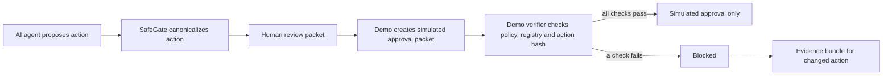

# SafeGate Edge Overview

SafeGate Edge checks AI and automation actions against policy. It computes a deterministic action hash and includes that hash and the evaluated policy in a review packet. Normal verification denies approval-required actions because the current packets lack authenticated approval evidence.

## Architecture Flow

## What the Demo Shows

- The review packet shows the action details, policy rule, expiration window and canonical action hash.
- The verifier checks the packet's hash, policy ID, rule and approval requirement. It checks that the named approver is active and that the caller-configured registry permits the method.
- The explicit demo can report a matching simulated approval for demonstration only. It blocks changed requests and denied packets, and exports the decision trace for the changed request.

## Current Limitations

- Execution authorization for approval-required actions requires authenticated approval evidence. Hardware-backed verification is future work.
- The calling application must submit the action for verification and enforce the decision before execution.

## Next Milestone
Replace simulated approvals with authenticated approval evidence. Candidate methods include FIDO2/WebAuthn, YubiKey/PIV, TPM-backed signing and passkeys.
