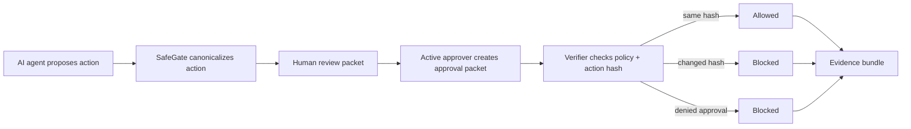

# SafeGate Edge Overview

SafeGate Edge is a local, verifiable approval boundary for high-risk AI and automation actions. Standard IAM tools focus on *who* is allowed to act; SafeGate focuses on *what exact action* is being approved. It converts an action request into a deterministic canonical hash, generates a human review packet, creates a hash-bound approval packet, and verifies that the attempted action still matches the approved hash before allowing it.

## Architecture Flow

## What the Demo Proves
- **Canonical action hashing:** SafeGate produces a deterministic cryptographic hash for the exact action request, avoiding drift from JSON formatting differences.
- **Human review contract:** SafeGate generates a review packet showing the plain-language action summary, raw action details, policy rule, expiration, and canonical action hash.
- **Hash-bound approval:** An approval packet binds an active approver, review ID, policy rule, action ID, and canonical action hash into one verifiable artifact.
- **Fail-closed mutation blocking:** If the attempted action changes after approval, SafeGate detects the hash mismatch and blocks the action.
- **Denied approval blocking:** A denied approval packet cannot be treated as permission.
- **Policy-bound verification:** SafeGate only allows approval-free actions when a valid policy explicitly says approval is not required.
- **Tamper-evident evidence:** The demo exports a hash-linked evidence bundle showing the decision trace from review through verification.

## Current Limitations
- **Hardware attestation is not implemented yet:** SafeGate is hardware-ready, not hardware-verified. The current demo uses simulated approval packets.
- **Approver identity is local and static:** The approver registry is currently a JSON configuration file, not a production identity provider integration.
- **No kernel-level sandboxing:** SafeGate is currently a verifier and approval gateway. It relies on an agent framework to call it before execution.
- **Prototype evidence, not certification:** The demo proves the control-plane pattern. It does not certify production security.

## Next Milestone
**Real Hardware-Backed Approval**: Replacing simulated approvals with real hardware-backed approval evidence (FIDO2/WebAuthn, YubiKey/PIV, TPM-backed signing, or passkey-style human-presence verification).
